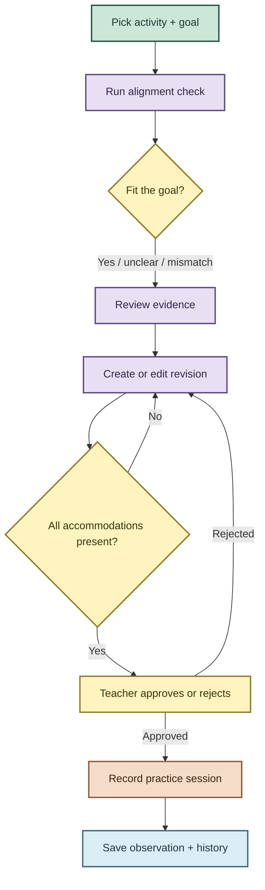
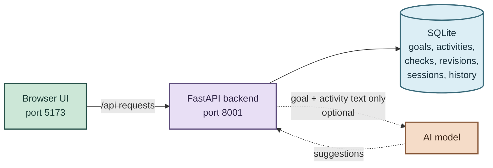

# StriveTrack: Project Documentation

This document explains what StriveTrack is, how to run and use it, what it depends on, and where external libraries and AI assistance were used. It is written for teammates reviewing or extending this prototype.

---

## 1. What this project is

**StriveTrack** is a local teaching workspace for special-education teachers. It helps a teacher check whether an everyday activity actually practices a learner’s approved IEP goal (especially executive-function skills such as planning and sequencing), revise the activity while keeping every approved accommodation, and record a practice session afterward.

| This prototype does | This prototype does not |
| --- | --- |
| Compare an activity to an approved goal | Write or change an IEP |
| Quote evidence when the activity does the planning work for the learner | Diagnose a learner or score mastery |
| Guard revisions so approved accommodations cannot be dropped silently | Provide production school sign-in or multi-tenant security |
| Let teachers record practice order, reasoning, prompting, and observations | Give learners their own accounts |

All demo content is **synthetic**. Cedar Grove is a fictional school. No real learner data belongs in this app.

**Primary demo user:** Maya Brooks (special-education teacher).  
**Learner story used in the seed:** Jordan (executive-function goal: choose and explain a workable order for task cards). Many worksheets currently number the steps for him instead.

---

## 2. How it works (functionality)

Teachers sign in to a shared demo workspace and move through these areas:

1. **Overview:** counts, weekly chart, and recent activities from the backend.
2. **Goal library:** create, edit, archive, search, and delete approved goal records (skill, success criteria, accommodations, due date).
3. **Activities:** worksheets linked to goals; create/edit and open an alignment check.
4. **Alignment check:** run a local (and optionally AI-assisted) check, inspect quoted evidence and a demand map, generate a revision, edit it, then approve or reject it. Approval is blocked if any approved accommodation is missing from the draft.
5. **Practice session:** after approval, present task cards, record the learner’s chosen order and explanation, prompting, and supports used. Optional aids: larger text, easier reading spacing, browser read-aloud, thinking-time timer. No mastery score is produced.
6. **Activity history:** append-only trail of checks, edits, approvals, rejections, observations, and sessions.

A check is marked **out of date** if the goal or activity text changes after it ran.

**Core rule:** AI may suggest; StriveTrack verifies quotes and accommodations in code; the teacher decides.

---

## 3. Simple diagrams

### 3.1 User flow

How a teacher moves through the app in a typical session:

```mermaid
flowchart LR
  A[Sign in] --> B[Overview]
  B --> C[Goals / Activities]
  C --> D[Alignment check]
  D --> E[Approve revision]
  E --> F[Practice session]
  F --> G[History]

  classDef start fill:#cce7d7,stroke:#244f47,color:#1a3a34,stroke-width:2px
  classDef step fill:#e8dff5,stroke:#5b4a7a,color:#2f2545,stroke-width:2px
  classDef action fill:#f5dcc8,stroke:#8a5a3a,color:#3a2416,stroke-width:2px
  classDef endNode fill:#dceef5,stroke:#3a6a7a,color:#1e3540,stroke-width:2px

  class A start
  class B,C step
  class D,E,F action
  class G endNode
```



Learners do not sign in. The teacher runs practice and records what happened.

### 3.2 Workflow

Main teaching loop: check, revise, decide, then practice:



Optional AI can help with the check and the first revision draft. Local rules still verify quotes and supports. The teacher always makes the final decision.

### 3.3 Data flow

Where information travels when the teacher uses StriveTrack:



- Solid lines always run (UI ↔ API ↔ SQLite).
- Dashed line is optional. If AI is off or fails, the backend uses local rules instead.
- Learner codes, sessions, and observations stay in SQLite and are never sent to the AI.

---

## 4. How to use it

### 4.1 Start the app

**Technical requirements**

| Requirement | Detail |
| --- | --- |
| Node.js | **20.19+** or **22.12+** (npm included) |
| Python | **3.9+** with `venv` and pip (setup prefers 3.12 → 3.11 → 3.10 → `python3` / `python`) |
| Network | Needed only for the first dependency install; the app then runs offline unless AI is enabled |
| Browser | Any modern browser; open `http://127.0.0.1:5173` |

From the project root:

```sh
npm run setup
npm run dev
```

- Frontend: **http://127.0.0.1:5173**
- API: **http://127.0.0.1:8001/api**
- Interactive API docs: **http://127.0.0.1:8001/docs**

Stop with **Ctrl+C**. After the first setup, `npm run dev` alone is enough.

Optional AI: copy `.env.example` to `.env`, set `STRIVETRACK_AI_API_KEY`, restart `npm run dev`. Without a key, local rules run fully offline. The Alignment check screen shows whether AI is on.

### 4.2 Demo sign-in

Password for every account: **`strivetrack-demo`**

| Name | Email | Role label |
| --- | --- | --- |
| Maya Brooks | `teacher@strivetrack.demo` | Teacher |
| Casey Nguyen | `casey@strivetrack.demo` | Teacher |
| Elena Rivera | `admin@strivetrack.demo` | Administrator |

Roles are labels only; there is no production permission system. All three share one synthetic workspace.

### 4.3 Short walkthrough

1. Sign in as **Maya Brooks**.
2. Open **Alignment check** → **Practice a café opening routine**.
3. Run the check (local rules quote numbered steps such as “1. Gather the cleaning supplies”).
4. Create a revision; confirm every accommodation is still present.
5. Approve → **Run a practice session** → record order, reasoning, and an observation.
6. Open **Activity history** to see the decision trail.
7. Use **Reset demo workspace** anytime to restore the seed.

### 4.4 Verify the build

```sh
npm run check          # ESLint, TypeScript, production frontend build
npm run test:backend   # API / auth / guards / reset tests
npm run test:launcher  # Port / service helper tests
```

End-to-end browser tests: keep `npm run dev` running, then `npm run test:e2e` (requires Playwright/Chromium; see README for browser path notes).

---

## 5. Architecture and technical stack

```text
project root/
  package.json              setup, combined startup, verification scripts
  requirements.txt          points at backend/requirements.txt
  .env.example              optional AI and path overrides (no secrets required)
  scripts/                  cross-platform setup/dev/test launchers
  frontend/                 React + TypeScript UI (Vite)
  backend/                  FastAPI + SQLite API
  seed/                     synthetic demo records
  docs/                     architecture notes (HTML/PDF)
```

| Layer | Technology | Role in this project |
| --- | --- | --- |
| UI | React 19, TypeScript, Vite, React Router | Screens, routing, local demo UX |
| Data fetching | TanStack Query | Server state, cache, retries |
| Motion / icons / toasts | Framer Motion, Lucide, Sonner | UI polish; no remote asset CDN |
| Styling | Tailwind CSS v4, Fontsource Nunito | Local fonts and layout |
| API | FastAPI, Pydantic, Uvicorn | REST API, validation, CORS for local UI |
| Persistence | SQLite (`backend/.data/strivetrack.sqlite3`) | Seeded demo store; no DB server |
| Optional AI | OpenAI-compatible HTTP API (`httpx`) | Demand map, findings, revision draft |
| Tests | pytest, Node test runner, Playwright | Backend, launcher, browser checks |

Default ports: frontend **5173**, backend **8001**. Vite proxies `/api` to the backend. Environment variables are listed in `.env.example` (`STRIVETRACK_AI_*`, optional `STRIVETRACK_PYTHON`, `STRIVETRACK_DB`, `VITE_API_URL`).

Pinned backend packages live in `backend/requirements.txt`. Exact frontend versions are locked in `frontend/package-lock.json`.

---

## 6. External resources (libraries and services)

These are third-party dependencies the team intentionally integrated. They are not “hidden” generated code; they are normal open-source libraries installed via npm/pip.

### Backend (Python)

| Package | Purpose |
| --- | --- |
| FastAPI | HTTP API framework |
| Uvicorn | ASGI server |
| Pydantic | Request/response validation |
| httpx | Calls the optional AI chat-completions endpoint |
| pytest | Backend automated tests |

### Frontend (JavaScript/TypeScript)

| Package | Purpose |
| --- | --- |
| React / React DOM | UI components |
| Vite + `@vitejs/plugin-react` | Dev server and production build |
| TypeScript / ESLint | Typing and linting |
| React Router | Client-side routes |
| TanStack Query | API caching and mutations |
| Tailwind CSS / `@tailwindcss/vite` | Styling |
| Framer Motion | Motion (respects reduced-motion) |
| Lucide React | Icons |
| Sonner | Toast notifications |
| Fontsource Nunito | Local font files (no Google Fonts runtime fetch) |
| Playwright | Optional end-to-end browser tests |

### Optional external service (AI)

| Setting | Default / notes |
| --- | --- |
| Endpoint | OpenAI-compatible chat completions (default base URL in `.env.example`: ASU Research Computing OpenAI-compatible gateway) |
| Model | Configurable (`STRIVETRACK_AI_MODEL`; default example: `qwen3-30b-a3b`) |
| Auth | `STRIVETRACK_AI_API_KEY` in `.env` (git-ignored) |
| Data sent | **Only** goal text and activity text; never learner codes, sessions, or observations |
| If unavailable | App falls back to deterministic local rules and labels the mode for the teacher |

Typography, icons, charts, and clay UI surfaces are rendered locally. The running demo does not require CDNs or analytics services.

---

## 7. AI assistance disclosure

### 7.1 AI inside the product (runtime)

StriveTrack can optionally call a large language model to:

1. Build an executive-function **demand map** (planning, sequencing, task initiation, working memory, self-monitoring, flexible thinking).
2. Suggest **findings** with quoted evidence from the activity.
3. Draft a **revision** (instructions, task cards, reflection prompt).

**Team-owned safeguards (implemented in our code, not left to the model):**

- Quotes must appear in the activity text or the finding is dropped.
- Only the six demand-map skills and allowed activity answers are accepted.
- Approved accommodations are injected/verified by code before approval.
- Every AI-assisted artifact is labeled with mode/model; teachers must approve before practice.
- Missing key or failed call → local rules; the UI states that clearly.

**Product principle:** *AI suggests. StriveTrack verifies. The teacher decides.*

### 7.2 AI used while building this prototype (development)

Parts of this codebase were produced or refined with **AI coding assistance** (for example Cursor/Composer during implementation and documentation). That assistance was used to accelerate scaffolding, UI copy, tests, and docs.

**What the team is expected to own:**

- Understand authentication (demo bearer tokens), SQLite seeding/reset, alignment rules, and accommodation guards.
- Be able to explain AI boundaries in `backend/app/ai.py` and enforcement in `backend/app/main.py`.
- Review behavior before any hackathon submission, classroom pilot, or further extension.
- Treat AI-generated snippets as draft material that has been (or must be) read and verified against this documentation and the tests.

AI coding tools did **not** replace the need for human review of educational claims, privacy limits, or production readiness. This remains an MVP with simulated sign-in and synthetic data only.

---

## 8. Limits the team should remember

- The checker is a pattern/rule helper, not a validated educational assessment.
- Authentication is simulated (`demo-…` tokens); not suitable for real schools as-is.
- No FERPA-ready hosting, SSO, or IEP-system integration in this prototype.
- Browser speech voices depend on the user’s OS/browser.
- Do not enter real learner personally identifiable information.

For a longer feature tour, API route table, and roadmap, see [README.md](README.md). For a visual workflow/architecture walkthrough, see [docs/architecture.html](docs/architecture.html).

---

## 9. Quick reference

| Item | Value |
| --- | --- |
| App URL | http://127.0.0.1:5173 |
| API URL | http://127.0.0.1:8001/api |
| Demo password | `strivetrack-demo` |
| Setup | `npm run setup` |
| Run | `npm run dev` |
| AI config template | `.env.example` |
| Database file | `backend/.data/strivetrack.sqlite3` |
